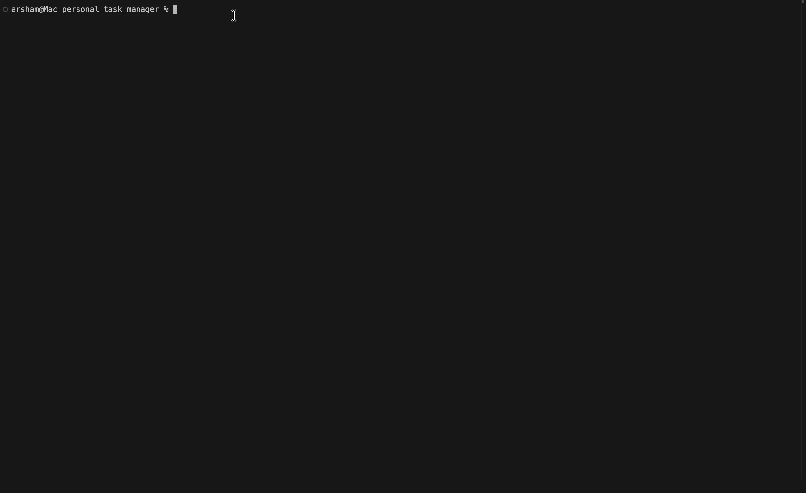

# Personal Task Manager


A personal task management app built with Python. 

## Table of Contents

- [Features](#features)
- [Project Structure](#project-structure)
- [Requirements](#requirements)
- [Installation](#installation)
- [Environment Setup](#environment-setup)
- [Usage](#usage)
- [Example Output](#example-output)
- [Screenshot](#screenshot)
- [Demo](#demo)
- [Roadmap](#roadmap)
- [Contributing](#contributing)
- [License](#license)
- [Author](#author)

## Features
- Personal task management system
  - Asks user to add new tasks
  - Creates tasks list
  - Shows all tasks
  - Show tasks status
- Tasks storage
  - Keeps task list for every user in `tasks.txt`
- Admin mode
  -  Requests an admin password and checks it
  - Protects private info outside main python file
  - Loads admin password from `.env`

## Project Structure
```text
personal_task_manager/
├── pictures/
│   ├── 1.png
│   ├── 2.png
│   └── 3.png
├── gifs/
│   └── demo.gif
├── main.py
├── tasks.py
├── requirements.txt
├── .env.example
├── .gitignore

```
### File Description

| file | description |
| --- | --- |
|`main.py`| main file used to run the task manager app |
|`tasks.py`| maintains the tasks functionality, adds new tasks to a list |
| `requirements.txt` | lists the neccessary python packages|
|`.env.example`| showcases necessary project environment variables |
|`.gitignore`| a list of files and folders to not be tracked by git |
| `README.md` | contains project documentation |
| `pictures/` | stores project screenshots|
| `pictures/1.png` | screenshot of task manager start|
| `pictures/2.png` | screenshot of adding tasks |
| `pictures/3.png` | screenshot of the final tasks list|
| `gifs/` | stores demo GIF files|
| `gifs/demo.gif` |shows the project demo|

## Requirements

Before running the project, ensure you have the necessary components installed:
- `python3`
- `python-dotenv`

## Installation

1. Open a terminal tab in the project directory
2. Check that Python is installed:
```bash
python --version
```
or
```bash
python3 --version
```
3. Install the required Python pacakges:
```bash 
pip install -r requirements.txt
```

## Environment Setup

1. Open a terminal tab in the project directory
2. Create a `.env` file based off `.env.example`:
```bash
cp .env.example .env
```
or
```powershell
copy-item .env.example .env
```
3. Open the new `.env` file
4. Replace the example value with a password of your choice
```text
TASK_MANAGER_ADMIN_PASSWORD=your_password_here
```
5. Save the file
> Do not commit your `.env` file, it contains private information

## Usage

1. Open a terminal tab in the project directory
2. Run the mini shop
```bash
python main.py
```
or
```bash
python3 main.py
```
3. Enter `yes` to enter admin mode, otherwise enter `no`
4. If entering admin mode, enter password from `.env` file
5. Enter your name
6. Enter a task and press return
7. Enter more tasks, once done, enter `q`
8. See your list of tasks
9. Task list is saved in the `tasks.txt` file 

## Example Output

```text
Open admin mode? (yes/no): no

Welcome!
Enter username: alex

Enter a task (`q` to stop): shopping
Enter a task (`q` to stop): homework
Enter a task (`q` to stop): call mom
Enter a task (`q` to stop): q

------
alex's current tasks: 
 - shopping
 - homework
 - call mom
 ```

## Screenshot

### Task Manager Start


### Adding tasks


### Tasks list


## Demo



## Roadmap

- [x] Add basic task management capabilities
- [x] Save user tasks to external file
- [x] Add admin mode
- [ ] Add admin specific features
- [ ] Load tasks from external file via username

## Contributing

## License

## Author

Created by [Arsham Banavi](https://github.com/arsham-banavi).